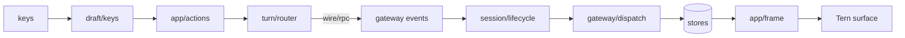

# hermes-tern frontend

The chat UI that `hermes tern` runs. It describes the UI to [Tern](https://stencil.so/tern) over
the Tern Surface Protocol (TSP) instead of painting terminal cells: the transcript, tool calls,
thinking, the composer and every sheet are semantic nodes that the terminal lays out, draws and
animates natively. It is a sibling of Hermes' Ink TUI (`ui-tui/`), and it talks to the same
backend, `tui_gateway`, over the same JSON-RPC contract.

## Running

The plugin's `hermes tern` command (`../__init__.py`) runs `hermes chat --tui` with
`HERMES_TUI_DIR` pointing here, so Hermes' launcher starts `dist/entry.js`. The frontend asks the
terminal for TSP first. A terminal that does not answer makes it exit with code 75, and
`hermes tern` runs the Ink TUI in its place.



## Layout

| Path | What |
| --- | --- |
| `src/entry.ts` | Handshake (`@stencil-hq/tern`), gateway start, `App` |
| `src/app/` | The composition root: `chat.ts` (`App`: one inline surface, gateway events → transcript, keys → overlay → completion → composer; its ports, run and quit), `stores.ts` (every store, made in dependency order and wired together), `actions.ts` (what the user starts, bound once), `frame.ts` (one coalesced render per change), `ports.ts` (what App lends the modules it drives) |
| `src/chrome/` | The pane's chrome around the chat: the pills above the composer and their keys, the status strip's notices, the backend's own failures, the connection's lost and redial lines, the session sidebar (`sidebar.tsx`: branch, PRs, changes), and the theme with its Tern program palette (`t`) |
| `src/session/` | The open session: its state (ids, info, usage, busy-input mode, and the tickets awaited work checks), its lifecycle (the first session, new, resume, reattach, switches and the requests held across one), the ordered steps of an adopt, the views this pane holds on the gateway, which gateway traffic belongs to it (`flow.ts`), its standing /goal and /loop, and its settings and name: reasoning effort, fast mode, title, thoughts |
| `src/model.ts` | The structured transcript's types (prompts, turns of thinking/text/tool blocks, notices, panels) |
| `src/transcript/` | The transcript folded from gateway events (`store.ts`) and its parts: compactions, a reload from history, finding calls, todos, subagent rows, what a stored prompt carried, and what a message says (Hermes' notices, steers) |
| `src/turn/` | Prompts on their way to the agent: the `Prompt` kinds (typed, the app's, a command's), the router that sends, steers, queues or holds each one through its entry point's gate, `{!cmd}` expansion, the turn's controls (interrupt, steer, redirect), the working line's busy state and compaction phase (`Activity`), and the queue behind the turn (held here, and the shared gateway's FIFO with this pane's admissions) with its Edit, Steer and drain |
| `src/draft/` | The draft: the prompt editor's model (`composer.ts`: text, caret, undo, history, kill ring), its live Markdown, its keys, and what it carries beside its text: the attached images (clipboard, pasted paths, `/image`, the launcher's `--image`) and those still uploading |
| `src/commands/` | Slash commands: those this frontend runs itself (`local.ts`), the turn controls and session commands the shared gateway serves through their own RPCs (`control.ts`, `session.ts`), those its `slash.exec` refuses (`refused.ts`), a typed name's resolution (`resolve.ts`) and the `slash.exec` path (`slash.ts`) |
| `src/view/` | Node builders (TSX on the Tern SDK's runtime) for the transcript, tool cards, dock and welcome card; `format.ts` holds how they write text, durations, times and paths, and `workLogModel.ts` how a turn's work groups and its steps and working line read. Only the modules that draw import it (docs/conventions.md) |
| `src/tools/` | Tool details: each call's args and result read once (lenient: a field of the wrong type reads as absent) into a variant keyed by its tool, `detail.ts` holding the union and the parse memo; Tool Search's `tool_call` bridge unpacked (`bridge.ts`) |
| `src/view/tools/` | Tool calls as `tool` nodes: `registry.ts` holds one view per tool (its card, step line, action and hub icon), `shell.tsx` wraps a call's card, `cards/` holds one module per card family (terminal, read, edit, search, web, task, ask, eval, connect, apps, images, the small inline ones, the generic fallback) with its tools' views |
| `src/code/` | Code helpers the views share: a file's highlighting language, unified diff hunks and counts |
| `src/view/ui/` | The parts the views share: pills, buttons and the action row, the shimmer and working row, sections headed by a child, facts lists |
| `src/overlays/` | Floating sheets (`overlay.ts` is their contract): approvals, clarify, masked prompts, completions, pickers |
| `src/prompts/` | The prompt sheets on the overlay stack: their keys, and closing them when the gateway withdraws their questions |
| `src/connections/` | Connect cards: the card files the plugin writes (`cards.ts`), and the watcher that keeps each card current and tells the agent |
| `src/hermes/` | Hermes' own runtime and files: the gateway client, its `state.db` (the session index, the compaction boundaries), paths, shell, history |

The views speak omp's chat vocabulary (`omp.session`, `omp.user`, `omp.assistant`,
`omp.thinking`, `omp.editor`, `tool` names like `bash`/`read`/`edit`): Tern's chat styles
(Reader, Spine, Console), tool folding and Carly's agent integration are written against those
roles, so Hermes gets them as-is. The `hello` names the program `hermes`, which Tern uses for
its icon, deck tile and branding.

`@tui/*` imports reach the renderer-free modules of `ui-tui/src` (the gateway transport, skins,
history, completion requests); nothing here imports React or Ink.

## LSP source links

A stored or live structured Hermes `lsp_result` presents references grouped by file,
nested symbols with stable IDs and source/selection ranges, and hover contents.
Source paths, reference rows, symbol labels and hover ranges become openable
`file:///` targets only when the **current** session explicitly reports
`terminal_backend: local`, the session `cwd` is absolute, the gateway is not
attached, a session is active, and none of `SSH_CONNECTION`, `SSH_CLIENT` or
`SSH_TTY` is set. Relative result paths resolve against session cwd, never
the renderer process cwd. Tern handles opening; column fragments remain
terminal-dependent. No filesystem probe, new LSP RPC or backend change is made.

Unknown, attached, SSH, remote and missing-cwd contexts display the literal
results without file links. Changing host or cwd invalidates transcript caches
even when the tool's revision is unchanged. Legacy/malformed payloads retain
the generic card. Source and provenance: Hermes `ui-tsp/LSP.md` and
`ui-tsp/src/view/lsp-diagnostics.tsx`, using the Tern/Stencil MIT SDK.

## Edit/write LSP companion diagnostics

Hermes `patch` and `write_file` may return `lsp_diagnostics_data` beside their
normal diff/content and legacy `lsp_diagnostics` prose. The existing
`tools/files.ts` detail parser validates the entire companion before rendering.
Native collapsible severity groups retain each returned file, one-based
UTF-16 start line/column, message and omitted count. They also retain source
and complete end line/column **when actually provided**; the pinned Hermes
producer currently returns start positions only, so the UI never invents
end positions. The companion is diagnostic enrichment, not a failed tool status.

The same verified host-local session evidence as the LSP result card gates
each diagnostic file/range hyperlink; remote, attached, SSH and unsafe targets
remain visible text without a clickable target. Malformed or older companion
data uses legacy `lsp_diagnostics` text when present, while an explicit
`unavailable` status shows a non-error note. New-file code, patch diffs and
diff-less results retain diagnostics. No second workspace/host authority,
Hermes runtime/tool registration or gateway request is introduced.

Adapted from Hermes `ui-tsp/src/view/tools.tsx`,
`ui-tsp/src/view/lsp-diagnostics.tsx` and
`agent/lsp/reporter.py` at donor `724b2aae`. Tern/Stencil's MIT SDK
owns native section, tree and hyperlink rendering. This plugin does not
change the signed-off Hermes source pin.

OMP validation (from `frontend/` at the exact branch head):

```sh
bun install --frozen-lockfile
bun run typecheck
bun run check:strict
bunx vitest run src/__tests__/lspResults.test.ts src/__tests__/files.test.ts src/__tests__/toolRegistry.test.ts
bun run check
bun run bundle
```

## Developing

```sh
bun run bundle        # builds dist/entry.js for local runs (TSP_OUT=… overrides); main's CI commits it
bun run typecheck
bun run test          # vitest
bun run lint          # eslint, held to scripts/lint-legacy.json (docs/conventions.md)
bun run check         # the Hermes pin, typecheck, tests, lint and the ratchets
bun run bundle:report # bytes per src/ module against a saved baseline (--save records one)
```

`hermes-src.lock` holds the Hermes commit this frontend builds against. `bun run check` warns
when `.hermes-src` points somewhere else (`hermes update` moves it); a Hermes bump rewrites the
lock in its own commit.

`TERN_TSP_RECORD=<file>` records every TSP message as JSONL; Tern's `surface-play` replays it.
`HERMES_TERN_EVENT_LOG=<file>` writes every gateway event, and every server request as
`{"request": …}`, one JSON line each: the format of the golden replays' fixtures
(`src/__tests__/fixtures/`), which `golden.test.ts` feeds through the app between scripted keys.

The Tern SDK is [`@stencil-hq/tern`](https://www.npmjs.com/package/@stencil-hq/tern) from npm
([stencil-hq/tern-sdk](https://github.com/stencil-hq/tern-sdk)), pinned like every other dependency.

## Missing Tern documents

The presentation surface recovers from an explicit whole-surface `gone` while visible, at most
three times per frontend lifetime. Every replacement has a new `hermes.recovery-N` id and a
fresh stylesheet, palette, view/retention writer and handler epoch; the gateway session, current
transcript, queued prompts, draft/caret and open request overlays are **not** restarted. If a
surface disappears while hidden, only a subsequent explicit visible event can reopen it.

Child `gone` reports reconcile just the missing view IDs; retained settled history remains cold
until explicit reload. No stale handler, focus or raw operation may target an evicted child.
ACKs are real Tern credits; hidden frames pause. A blocked visible surface reports a five-second
stall once without sending an escape frame, creating credit, or reopening on a timer. Protocol
rejection, malformed ACK/error/gone, or view failure reports to stderr/transcript and stops the
surface. Reconnect the frontend to recover from a failure or an exhausted three-replacement
budget. Normal shutdown still uses the SDK's original kept-scrollback close behavior.

Verification: `cd frontend && bun install --prefer-offline --frozen-lockfile && bun run check &&
bun run test -- src/__tests__/surfaceRecovery.test.ts src/__tests__/watchRecovery.test.ts src/__tests__/watch.test.ts src/__tests__/retention.test.ts
src/__tests__/appDispose.test.ts && bun run bundle`. These tests use the real pinned
`@stencil-hq/tern` SDK with a strict simulated TSP document peer. They do not prove a
native Tern window-loss/re-attach: run that separately in an owned isolated headless Tern pane.


### Watch pane recovery

The subagent Watch pane uses the same bounded visible-surface recovery, native
callback epoch fences, stylesheet and palette restoration as chat. Its existing
single render scheduler and subagent poller continue from the same agent state,
child transcript and unsent draft. Child node loss is reconciled even while
hidden; an explicit show redraws it without reopening the gateway session.
The running dock exposes Stop, not a separate Send button. Steering uses native
editor Send or composer Enter; both commands stay bound to the visible current epoch.
The watch input loop reports protocol/render failures and disposes surface
diagnostics before closing Tern. No native window-loss injection is claimed by
the SDK-peer tests; verify separately in an owned isolated Tern pane.
